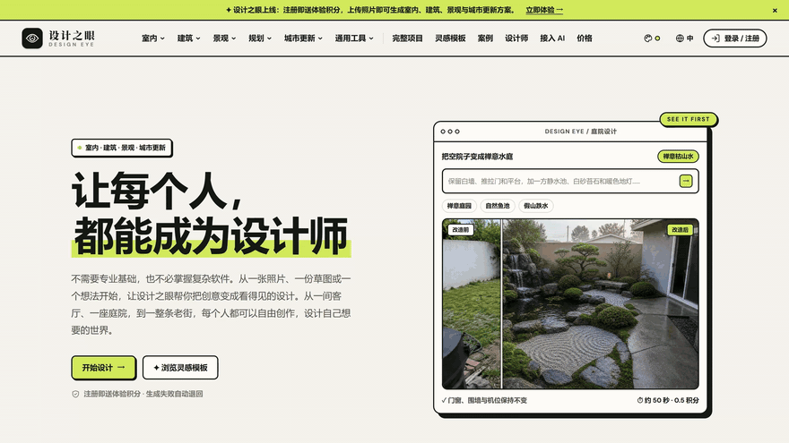
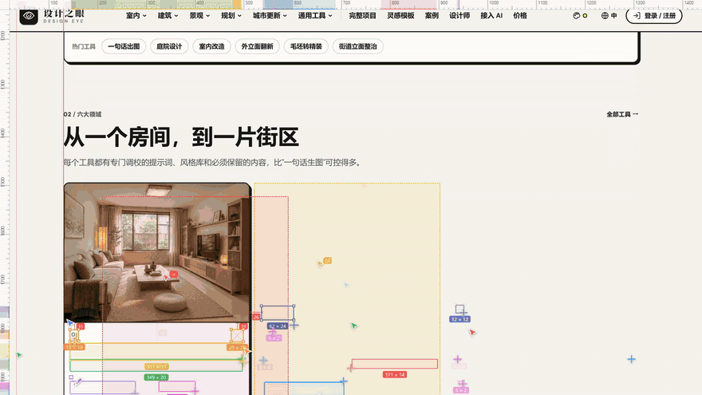

<div align="center">


# Agent Reveal

**Turn any finished web page into a "swarm of AI agents building it" demo — and record it to MP4 automatically.**

[](LICENSE)
[](https://github.com/AXBIAO/agent-reveal/actions/workflows/ci.yml)


[简体中文](README.md) · English

</div>

<p align="center">
  
  
</p>

The page itself is never modified: the script hides its elements, then 3 → 26 colored cursors rebuild it piece by piece like a swarm. When it finishes (or you press <kbd>Esc</kbd>) the page is restored exactly. Great for product promos, launch demos and short-video material.

## Features

- **Swarm of cursors** — the crowd grows over time; each cursor flies to a corner, presses, drags a marquee to the opposite corner (live size label), releases, and the content appears inside the box
- **Only working cursors are visible** — idle cursors fade out instead of floating around
- **Human-like typing** — headings get typos (repeated, swapped or wrong characters), a pause, backspaces, then the correct text; the cursor follows the caret
- **Design-tool look** — selection handles, `W × H` labels and a live `agents | layers | Typing…` status bar
- **Clean MP4 recording** — WebCodecs H.264 + [mp4-muxer](https://github.com/Vanilagy/mp4-muxer); plays everywhere ([why not MediaRecorder?](#why-not-mediarecorder-for-mp4))
- **Shows where the file is** — the extension displays the real saved path, with *Show in folder* / *Open*
- **Exact restore** — original `style` attributes are written back byte for byte
- **Two ways to use it** — Chrome extension (recommended) or a zero-install bookmarklet

## Quick start

### Option 1 — Chrome extension (recommended, no Node.js needed)

1. Download `agent-reveal-extension-v*.zip` from [Releases](https://github.com/AXBIAO/agent-reveal/releases/latest) and unzip it to a **permanent folder**
2. Open `chrome://extensions` and turn on **Developer mode** (top right)
3. Click **Load unpacked** and select the unzipped folder (the one containing `manifest.json`)
4. Pin **Agent Reveal** from the puzzle-piece menu 🧩

> Works in Edge too via `edge://extensions`.

### Option 2 — Build from source

Requires [Node.js](https://nodejs.org/) 20+.

```bash
git clone https://github.com/AXBIAO/agent-reveal.git
cd agent-reveal
npm install
npm run build
```

Then follow steps 2–4 above and select the repo's `extension/` folder.

### Option 3 — Bookmarklet (nothing to install)

1. Download `install.html` from [Releases](https://github.com/AXBIAO/agent-reveal/releases/latest) and open it in Chrome (or open `dist/install.html` after building)
2. Show the bookmarks bar (<kbd>Ctrl</kbd>+<kbd>Shift</kbd>+<kbd>B</kbd>) and **drag** the "▶ Agent Reveal" button onto it
3. Open any website and click the bookmark

With the bookmarklet, Chrome asks you to share the tab before recording starts, and the video goes to your default downloads folder.

## Usage

1. Open the page you want to demo and **wait until it has fully loaded**
2. Click the Agent Reveal toolbar icon, adjust the settings, press **▶ Start**
3. Don't interact with the page while it runs; press <kbd>Esc</kbd> to stop (the recording is discarded)
4. When it finishes, a panel shows the full path of the saved video

Shortcut: <kbd>Alt</kbd>+<kbd>Shift</kbd>+<kbd>R</kbd> starts with your last settings (change it at `chrome://extensions/shortcuts`).

| Setting | Default | Description |
| --- | --- | --- |
| Auto record | on | Records the current tab and saves an MP4 at the end |
| Max cursors | 26 | Maximum number of cursors at the same time (4–40) |
| Speed | 0.70× | Lower is faster; lower it for long pages |
| Show agent names | off | Shows `Agent 1`, `Agent 2`… next to each cursor |

Recordings are saved to `<Downloads>/agent-reveal/agent-reveal-<host>-<date>-<time>.mp4`.

**Tips:** press <kbd>F11</kbd> for fullscreen before starting, close DevTools and cookie banners, and use a high display scale for sharper output.

## Bookmarklet options

Set `window.AGENT_REVEAL_CONFIG` in the console before clicking the bookmark:

```js
window.AGENT_REVEAL_CONFIG = {
  maxAgents: 26, startAgents: 3, rampRatio: 0.2, durationMs: 30000,
  speed: 0.7, showNames: false, record: true,
};
```

## How it works

1. **Collect layers** — walk the DOM, collect text, images, controls and visible blocks as "layers", sort them top to bottom and hide them
2. **Swarm scheduling** — only layers already in the viewport are handed to idle cursors, so every cursor on screen is busy; the page auto-scrolls as the build front advances
3. **Marquee & reveal** — cursors drag a box, content appears inside on release; text is played from a typing script (typos, pauses, backspaces) without layout jumps
4. **Restore** — remove only the inline styles the script added, then write the original `style` string back if nothing else changed
5. **Recording** — tab capture → `MediaStreamTrackProcessor` → `VideoEncoder` (H.264) → `mp4-muxer`, at a fixed resolution with frame dropping under back-pressure

### Why not MediaRecorder for MP4

In our tests Chrome's `MediaRecorder` MP4 output has broken H.264 slices: ffmpeg reports 100+ decode errors per 6 seconds with heavy visual corruption, both headed and headless and independent of the page. WebCodecs + mp4-muxer produced zero errors under the same conditions. We fall back to `MediaRecorder` WebM only when WebCodecs is unavailable.

## FAQ

- **"This page can't run"** — `chrome://` pages and the Web Store block extensions; use a normal website.
- **The page doesn't scroll** — sites that scroll an inner container (instead of the window) aren't supported yet.
- **Some content just pops in** — content inserted after start (lazy-loaded lists) isn't collected; scroll through the page once before starting.
- **Permissions** — only `activeTab` (access to the current tab when you click the icon or use the shortcut), plus `tabCapture`/`offscreen` for recording, `downloads` to save and locate the video, and `storage` for settings.

## Development

```bash
npm run build      # bookmarklet (dist/) + extension scripts (extension/)
npm run test:unit  # unit tests
npm run test:e2e   # bookmarklet E2E (playback, restore, Esc, decodable recording)
npm run test:ext   # extension E2E (tabCapture recording, real-path panel, Esc)
npm test           # everything
```

E2E runs against `https://eye.zsf.si` by default; use `--url` to change it. The extension E2E uses Playwright's Chromium (`npx playwright install chromium`) because branded Chrome 137+ no longer loads unpacked extensions from the command line. See [CONTRIBUTING.md](CONTRIBUTING.md).

## License

[MIT](LICENSE) © 2026 AXBIAO · Third-party notices: [THIRD_PARTY_NOTICES.md](THIRD_PARTY_NOTICES.md)
