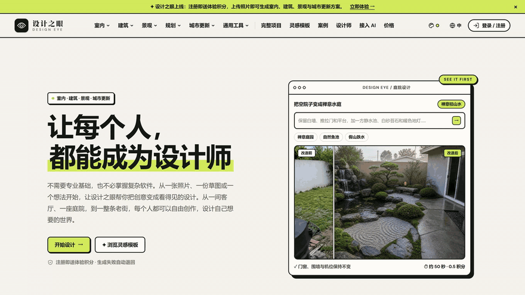
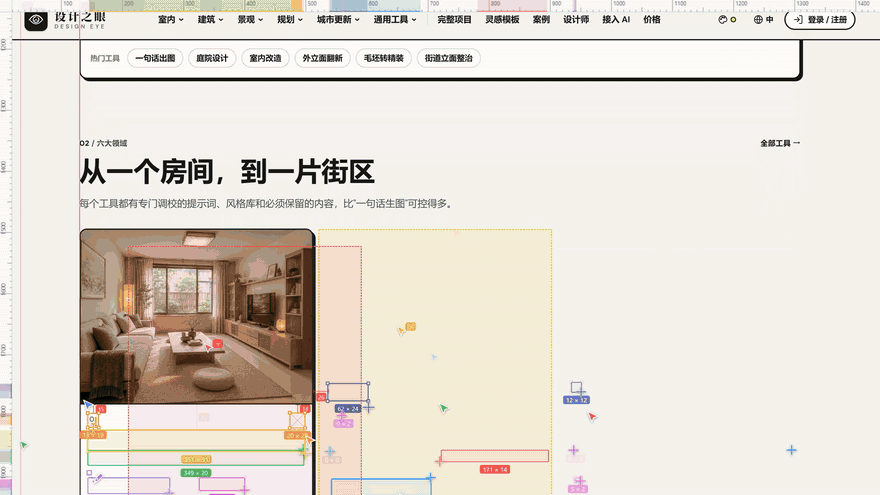
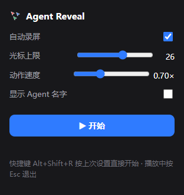
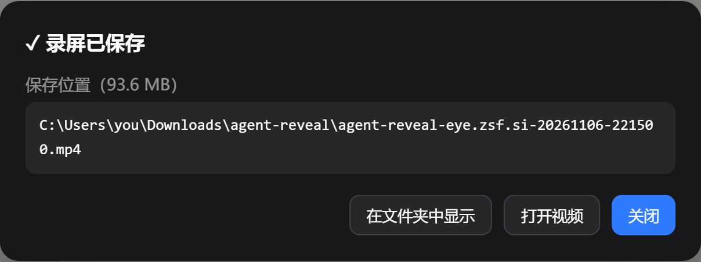

<div align="center">


# Agent Reveal

**把任何一个做好的网页，变成"一群 AI agent 正在协作搭建它"的演示动画，并自动录成 MP4。**

[](LICENSE)
[](https://github.com/AXBIAO/agent-reveal/actions/workflows/ci.yml)


简体中文 · [English](README.en.md)

</div>

<p align="center">
  
  
</p>

页面本身不做任何改动：脚本先把元素藏起来，再让 3→26 个彩色光标像蜂群一样逐个"搭"回来。跑完或按 <kbd>Esc</kbd> 后页面完全还原。适合做产品宣传片、发布会演示、短视频素材。

## ✨ 特性

- **蜂群式多光标**：光标数量随进度增长；每个光标飞到元素一角 → 按下 → 拖到对角拉出选框（尺寸实时变化）→ 松手吸附，内容出现在框内
- **只显示干活的光标**：没有任务的光标自动淡出，画面里不会有光标闲着乱飘
- **真人打字**：标题会打出重复字、颠倒、错字，停顿后退格改对（例如先打出"让让"再改成"让每个人"）；光标跟着打字位置走
- **设计软件质感**：选框带控制点和 `宽 × 高` 标签，右下角状态条实时显示 `agents | layers | Typing…`
- **自动录屏，输出标准 MP4**：用 WebCodecs 编码 H.264，再用 [mp4-muxer](https://github.com/Vanilagy/mp4-muxer) 封装，剪映、Premiere、手机都能直接用（[为什么不用 MediaRecorder](#为什么不直接用-mediarecorder-录-mp4)）
- **告诉你文件存在哪**：扩展版跑完后弹出真实保存路径，支持「在文件夹中显示」「打开视频」
- **完全还原**：结束后逐字节恢复原始 `style` 属性，不影响页面后续交互
- **两种用法**：Chrome 扩展（推荐）或书签脚本（不用安装任何东西）

## 🚀 快速开始

### 方式一：安装 Chrome 扩展（推荐，不需要 Node.js）

1. 到 [Releases](https://github.com/AXBIAO/agent-reveal/releases/latest) 下载 `agent-reveal-extension-v*.zip`，解压到一个**固定的文件夹**（删掉这个文件夹，扩展就没了）
2. Chrome 地址栏打开 `chrome://extensions`，打开右上角的 **开发者模式**
3. 点 **加载已解压的扩展程序**，选择刚解压出的文件夹（里面直接就是 `manifest.json`）
4. 点工具栏的拼图图标 🧩，把 **Agent Reveal** 固定到工具栏

> Edge 也可以用：打开 `edge://extensions`，步骤相同。

### 方式二：从源码构建

需要 [Node.js](https://nodejs.org/) 20 或更高版本。

```bash
git clone https://github.com/AXBIAO/agent-reveal.git
cd agent-reveal
npm install
npm run build
```

然后按方式一的第 2–4 步，在第 3 步选择仓库里的 `extension/` 文件夹。

### 方式三：书签脚本（什么都不用装）

1. 从 [Releases](https://github.com/AXBIAO/agent-reveal/releases/latest) 下载 `install.html`，用 Chrome 打开（或者源码构建后打开 `dist/install.html`）
2. 按 <kbd>Ctrl</kbd>+<kbd>Shift</kbd>+<kbd>B</kbd> 显示书签栏，把页面上的「▶ Agent Reveal」按钮**拖到书签栏**
3. 打开任意网站，点这个书签

书签版录屏时 Chrome 会询问「共享此标签页」，确认后才开始录；视频保存到浏览器默认下载文件夹。

## 📖 使用



1. 打开要演示的网页，**等它完全加载完**
2. 点工具栏的 Agent Reveal 图标，按需调整设置，点 **▶ 开始**
3. 动画开始后不要操作页面；中途想停就按 <kbd>Esc</kbd>（录屏会丢弃）
4. 跑完后弹出保存面板，显示视频的完整路径

也可以直接按 <kbd>Alt</kbd>+<kbd>Shift</kbd>+<kbd>R</kbd>，用上次的设置开始（可在 `chrome://extensions/shortcuts` 修改）。

| 设置 | 默认 | 说明 |
| --- | --- | --- |
| 自动录屏 | 开 | 录当前标签页，跑完自动保存 MP4 |
| 光标上限 | 26 | 同时在场的光标最大数量（4–40） |
| 动作速度 | 0.70× | 越小越快；页面很长时可以调小 |
| 显示 Agent 名字 | 关 | 光标旁显示 `Agent 1`、`Agent 2`… |

<br clear="right">

<p align="center"></p>

### 录屏保存在哪

| 用法 | 保存位置 |
| --- | --- |
| 扩展 | `下载文件夹\agent-reveal\agent-reveal-<域名>-<日期>-<时间>.mp4`，面板里显示完整路径 |
| 书签 | 浏览器默认下载文件夹；浏览器不向网页暴露真实路径，面板里只能显示文件名。可按 <kbd>Ctrl</kbd>+<kbd>J</kbd> 打开下载列表，或点「另存为…」自己选目录 |

### 录出好看视频的小技巧

- 按 <kbd>F11</kbd> 全屏后再开始，画面里就不会有地址栏和标签栏
- 关掉开发者工具和页面上的弹窗、Cookie 横幅
- 屏幕缩放越高，录出来越清晰（150% 缩放的 1080p 屏会录成 2880×1800）
- 想要"手机实拍屏幕"的质感，可以关掉自动录屏，直接用手机拍

## ⚙️ 书签版配置

点书签前先在控制台（<kbd>F12</kbd>）设置 `window.AGENT_REVEAL_CONFIG`，再点书签：

```js
window.AGENT_REVEAL_CONFIG = {
  maxAgents: 26,     // 光标上限
  startAgents: 3,    // 开场光标数
  rampRatio: 0.2,    // 前 20% 时长内涨满
  durationMs: 30000, // 决定光标增长节奏（实际总时长取决于页面长度）
  speed: 0.7,        // 动作快慢，越小越快
  showNames: false,  // 光标旁显示 Agent N
  record: true,      // 自动录屏
};
```

## 🔧 工作原理

1. **收集图层**：遍历 DOM，把文字、图片、按钮、带背景或边框的块收集成"图层"，按从上到下排序后全部隐藏
2. **蜂群调度**：只把已经进入视口的图层分给空闲的光标，所以镜头里的每个光标都在干活；施工前沿推进时页面自动滚动
3. **拉框与出现**：光标拖拽画框，松手后内容在框内出现。文字按打字脚本逐帧呈现（含打错、停顿、退格），布局不跳动；块元素在框内淡入
4. **还原**：只撤掉脚本加的内联样式；剩余样式和原来一致时，把原始 `style` 字符串逐字节写回
5. **录屏**：采集标签页画面 → `MediaStreamTrackProcessor` 逐帧取出 → `VideoEncoder` 编码 H.264 → `mp4-muxer` 封装。分辨率固定，编码器积压时丢帧，内存不会无限增长

### 为什么不直接用 MediaRecorder 录 MP4

实测 Chrome 的 `MediaRecorder` 输出 MP4 时，H.264 分片有问题：用 ffmpeg 解码，每 6 秒就有一百多个错误，画面大面积花屏。有界面、无头模式都一样，跟网页内容无关。同样条件下，WebCodecs + mp4-muxer 的解码错误是 0。所以本项目用 WebCodecs 录 MP4；只有浏览器不支持 WebCodecs 时，才退回 `MediaRecorder` 录 WebM。

## ❓ 常见问题

**点了没反应 / 提示"这个页面不能运行"**
`chrome://`、Chrome 网上应用店等浏览器内置页面不允许扩展运行，换成普通网页即可。

**页面没有自动往下滚**
有些网站的滚动发生在页面内部的容器里，而不是整个窗口，目前不支持自动滚动这类页面。

**有的内容直接出现，没有被光标搭出来**
运行时才动态插入的内容（比如滚动后懒加载的列表），不在开始时收集的图层里。可以先把页面从头到尾滚一遍、等内容加载完，再开始。

**视频文件很大**
4K 屏一分钟大约 90MB。需要小文件的话，可以用剪辑软件导出，或者 `ffmpeg -i in.mp4 -crf 28 out.mp4` 压缩。

**扩展需要哪些权限？**
只用 `activeTab`：只有点工具栏图标或按快捷键时，扩展才能访问**当前这个**标签页，不会读取其他网站。另外 `tabCapture` + `offscreen` 用于录屏，`downloads` 用于保存视频并显示路径，`storage` 用于记住设置。

## 🛠 开发

```
src/                     动画与录屏源码（esbuild 打包）
  agent-reveal.js          主脚本：收集图层、蜂群调度、拉框、还原
  typing.js                真人打字脚本生成
  mp4-recorder.js          WebCodecs + mp4-muxer 录 MP4（失败时退回 WebM）
  recorder.js              书签版录屏（getDisplayMedia）与保存面板
  offscreen.js             扩展离屏录制页
extension/               Chrome MV3 扩展（build 会把 agent-reveal.js、offscreen.js 生成进来）
  manifest.json  sw.js  popup.*  page-ui.js  settings.js  naming.js
scripts/                 构建、文档截图、图标生成
tests/                   单元测试与 Playwright E2E
```

```bash
npm run build       # 构建书签（dist/）与扩展脚本（extension/）
npm run test:unit   # 单元测试：打字脚本、文件命名、设置校验
npm run test:e2e    # 书签 E2E：播放、还原、Esc、录屏可解码
npm run test:ext    # 扩展 E2E：tabCapture 录屏、真实路径面板、Esc 丢弃
npm test            # 全部
```

- E2E 默认在 `https://eye.zsf.si` 上运行，可用 `node tests/e2e.mjs --url https://example.com` 换站点
- 书签 E2E 使用本机 Chrome；扩展 E2E 使用 Playwright 自带的 Chromium，因为品牌版 Chrome 137+ 不再支持命令行加载扩展（需要 `npx playwright install chromium`）
- 改了 `src/` 之后要重新 `npm run build`，再到 `chrome://extensions` 点扩展的刷新按钮

欢迎提 Issue 和 PR，提交前请看 [CONTRIBUTING.md](CONTRIBUTING.md)。

## 📄 许可证

[MIT](LICENSE) © 2026 AXBIAO

打包进构建产物的第三方代码及其许可证见 [THIRD_PARTY_NOTICES.md](THIRD_PARTY_NOTICES.md)。
